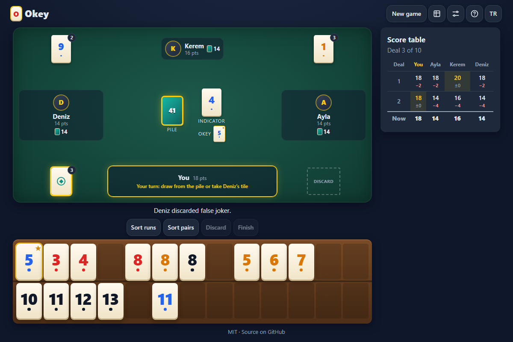

# Okey - the Turkish tile game in your browser, you against three computer players

[](#tests)
[](LICENSE)

**▶ Play now: https://celaldrg.github.io/okey/**



## Features

- The full Okey deal: 106 tiles, indicator and okey, sets, runs (11-12-13-1), seven pairs, wild okeys and false jokers.
- Three computer players that read the table: they take a discard only when it improves their hand, avoid feeding the next player, keep their okeys and switch to seven pairs when the hand calls for it.
- A rack of two rows of 13 slots: drag tiles with mouse or finger, or let "Sort runs" / "Sort pairs" lay them out by the best split.
- The app checks your finish, shows the groups it found and refuses an incomplete hand with a clear message.
- Scoring from 20 points, a score table per deal, games of 5, 10 or 20 deals, three computer speeds.
- English and Turkish, a built-in rules page, keyboard controls, works on phones (375 px and up).
- No build step, no dependencies, no network requests: plain HTML, CSS and JavaScript modules.

## How to play

Okey is the Turkish tile game of the rummy family. There are 106 tiles: the numbers 1 to 13 in four colors (red, yellow, blue, black), two of each, plus two false jokers.

- **Deal.** The tiles are shuffled. The starting player (it rotates every deal) gets 15 tiles, the others 14. One tile is turned face up as the indicator; a false joker is never the indicator. The okey is the tile of the indicator's color one number higher (13 wraps to 1). Both okey tiles are wild and can stand for any tile (they carry a small star in your rack). The false jokers play as the plain okey tile, with its color and number.
- **Turns.** Play passes counter-clockwise. On your turn draw either the top tile of the face-down center pile or the tile the previous player just discarded, then discard one tile for the next player. The starting player skips the draw and only discards.
- **Groups.** A set is 3 or 4 tiles of the same number in different colors. A run is 3 or more consecutive numbers of one color; 1 may follow 13 at the end (11-12-13-1), but a run never continues past it (13-1-2 is not a run).
- **Finishing.** You finish by discarding your 15th tile face down onto the center pile when the other 14 split completely into groups, or into seven pairs of identical tiles ("çifte gitmek"). Okey tiles can complete groups and pairs. If the center pile runs out, the deal ends without a winner.
- **Scoring.** Everyone starts the game with 20 points. When a player finishes, each other player loses 2 points, 4 if the finishing discard was an okey or the hand was seven pairs, 8 if both. A player holding a tile identical to the indicator may show it before their first discard of the deal, and each other player loses 1 point. A game is 5, 10 or 20 deals (10 by default) and ends early when a player reaches 0; the highest score wins.

**Touch / mouse**

- Drag tiles to rearrange your rack, or tap a tile and then tap an empty slot.
- Draw: tap the center pile or the glowing discard of the player on your left, or drag either onto your rack.
- Discard: tap a tile and press **Discard**, or drag it to your discard spot (bottom right).
- Finish: press **Finish** (it lights up when your hand can finish) or drop the finishing tile on the center pile.
- Tap any discard pile to see all of its tiles. **Show indicator** appears on your first turn when you hold the indicator's twin.

**Keyboard**

| Key | Action |
| --- | --- |
| Arrow keys | Pick a tile in the rack |
| Shift + Left / Right | Move the picked tile |
| D | Draw from the center pile |
| T | Take the previous player's discard |
| Enter | Discard the picked tile |
| F | Finish (with the picked tile, or the best finishing tile) |

## Run locally

Any static server works; ES modules need `http://`, not `file://`:

```sh
npx serve .
```

Then open the printed address. Add `?demo` to the URL for the fixed mid-game state used for the screenshot.

## Tests

```sh
node --test
```

The suite uses only `node:test` and `node:assert/strict`, is fully seeded and runs in a few seconds. It covers:

- 1,000 seeded deals: 15 + 14 + 14 + 14 tiles, an indicator that is never a false joker, 48 tiles in the center pile and 106 distinct tiles; okey determination (red 7 gives red 8, blue 13 gives blue 1) and false jokers standing for the okey's face.
- Group validation on 35 hand-made cases (repeated colors rejected, 11-12-13-1 accepted, 13-1-2 rejected, wilds in any position).
- The winning-hand check on 35 hand-made hands (groups, seven pairs, zero to two okeys, false jokers, near misses), each also checked against a separate reference.
- The hand solver against an exhaustive reference search on 200 seeded 14-tile hands.
- 200 seeded deals with four computer players: only legal draws and discards, hand sizes of 14 and 15, and every finish passes the winning-hand check.
- One computer player against three random-legal players over 200 deals: the computer wins 186 deals, the random players 1 (13 deals end with no winner).
- Rack layout (sorting, syncing, keyboard cursor), translations (both languages define the same strings) and the storage helper.

## Project structure

```
index.html          page shell, meta tags, favicon
style.css           dark theme, table, tiles and rack
src/
  rng.js            seeded random number generator
  tiles.js          tile set, okey, dealing
  solver.js         best split of a hand into groups
  groups.js         sets, runs, seven pairs, winning-hand check, scoring
  ai.js             computer player decisions
  game.js           deal and turn state machine
  rack.js           rack layout (pure)
  demo.js           the ?demo mid-game state
  i18n.js           English and Turkish strings
  storage.js        safe localStorage helper
  view.js           DOM builders
  dialogs.js        rules, settings, scores, deal results
  drag.js           pointer drag and drop
  main.js           app controller
test/               node:test suites
```

## License

[MIT](LICENSE) © 2026 Celalettin Durgaç

---

## Türkçe

**Okey - tarayıcında Türk taş oyunu, üç bilgisayar oyuncusuna karşı**

**▶ Hemen oyna: https://celaldrg.github.io/okey/**

### Özellikler

- Eksiksiz bir okey eli: 106 taş, gösterge ve okey, perler, seriler (11-12-13-1), çifte, joker okeyler ve sahte okeyler.
- Masayı okuyan üç bilgisayar oyuncusu: atılan taşı yalnızca ellerini iyileştirirse alırlar, sonraki oyuncuya taş yedirmekten kaçınırlar, okeylerini saklarlar ve el uygunsa çifteye giderler.
- 13'er yuvalı iki sıralı ıstaka: taşları fareyle ya da parmakla sürükle ya da "Seri diz" / "Çift diz" ile en iyi bölünmeye göre dizdir.
- Uygulama bitişini kontrol eder, bulduğu grupları gösterir ve eksik eli açık bir mesajla reddeder.
- 20 puandan başlayan puanlama, her elin puan tablosu, 5, 10 ya da 20 ellik oyunlar, üç bilgisayar hızı.
- İngilizce ve Türkçe, uygulama içi kurallar sayfası, klavye kontrolleri, telefonda çalışır (375 piksel ve üstü).
- Derleme yok, bağımlılık yok, ağ isteği yok: düz HTML, CSS ve JavaScript modülleri.

### Nasıl oynanır

Okey, rummy ailesinden Türk taş oyunudur. 106 taş vardır: dört renkte (kırmızı, sarı, mavi, siyah) 1'den 13'e kadar sayılar, her birinden iki tane, artı iki sahte okey.

- **Dağıtım.** Taşlar karılır. Başlayan oyuncu (her elde sırayla değişir) 15, diğerleri 14 taş alır. Bir taş gösterge olarak açılır; sahte okey asla gösterge olmaz. Okey, göstergenin renginde bir büyük sayıdır (13'ten sonra 1 gelir). İki okey taşı da jokerdir, her taşın yerine geçebilir (ıstakanda küçük bir yıldız taşırlar). Sahte okeyler düz okey taşı olarak, onun rengi ve sayısıyla oynar.
- **Sıra.** Oyun saat yönünün tersine döner. Sıran gelince kapalı orta destenin üstündeki taşı ya da önceki oyuncunun az önce attığı taşı çek, sonra sonraki oyuncu için bir taş at. Başlayan oyuncu çekmez, yalnızca atar.
- **Gruplar.** Per, aynı sayıda farklı renklerde 3 ya da 4 taştır. Seri, aynı renkte ardışık 3 ya da daha fazla sayıdır; 13'ten sonra sona 1 gelebilir (11-12-13-1) ama seri ondan sonra devam etmez (13-1-2 seri değildir).
- **Bitirmek.** Diğer 14 taş tamamen gruplara ya da yedi çift aynı taşa ("çifte gitmek") ayrıldığında 15. taşını orta destenin üstüne kapalı atarak bitirirsin. Okeyler grupları ve çiftleri tamamlayabilir. Orta deste biterse el kazanansız biter.
- **Puanlama.** Herkes oyuna 20 puanla başlar. Bir oyuncu bitirince diğer her oyuncu 2 puan kaybeder; bitiren taş okeyse ya da el çifteyse 4, ikisi birdense 8. Göstergenin aynısını tutan oyuncu eldeki ilk atışından önce onu gösterebilir ve diğer her oyuncu 1 puan kaybeder. Bir oyun 5, 10 ya da 20 eldir (varsayılan 10) ve bir oyuncu 0'a inince erken biter; en yüksek puan kazanır.

**Dokunmatik / fare**

- Taşları sürükleyerek ıstakanı düzenle ya da bir taşa, sonra boş bir yuvaya dokun.
- Çekmek: orta desteye ya da solundaki oyuncunun parlayan taşına dokun veya ikisinden birini ıstakana sürükle.
- Atmak: bir taşa dokunup **At**'a bas ya da taşı atma yerine (sağ alt) sürükle.
- Bitirmek: **Bitir**'e bas (elin bitebilecekse parlar) ya da bitiren taşı orta desteye bırak.
- Bir atılan taş yığınına dokunarak tüm taşlarını gör. Göstergenin aynısı sendeyse ilk sıranda **Göstergeyi göster** düğmesi çıkar.

**Klavye**

| Tuş | İşlem |
| --- | --- |
| Ok tuşları | Istakada taş seç |
| Shift + Sol / Sağ | Seçili taşı kaydır |
| D | Orta desteden çek |
| T | Önceki oyuncunun attığı taşı al |
| Enter | Seçili taşı at |
| F | Bitir (seçili taşla ya da en iyi bitiren taşla) |

### Yerelde çalıştırma

Herhangi bir statik sunucu yeterli; ES modülleri `file://` ile değil `http://` ile çalışır:

```sh
npx serve .
```

Sonra yazdırılan adresi aç. Ekran görüntüsündeki sabit oyun ortası durumu için adrese `?demo` ekle.

### Testler

```sh
node --test
```

Testler yalnızca `node:test` ve `node:assert/strict` kullanır, tamamen tohumludur ve birkaç saniyede biter. Kapsam: 1.000 tohumlu dağıtımda taş sayıları ve okey belirleme; 35 grup doğrulama örneği; 35 elle yazılmış bitiş eli (gruplar, çifte, sıfır-iki okey, sahte okeyler, kıl payı kaçanlar); 200 elde çözücünün kapsamlı bir referans aramayla karşılaştırılması; dört bilgisayar oyuncusuyla 200 elde yalnızca kurallı hamleler; bir bilgisayar oyuncusunun 200 elde üç rastgele oyuncuya karşı 186 el kazanması (rastgeleler 1, kazanansız 13); ıstaka düzeni, çeviriler ve depolama yardımcısı.

### Lisans

[MIT](LICENSE) © 2026 Celalettin Durgaç
